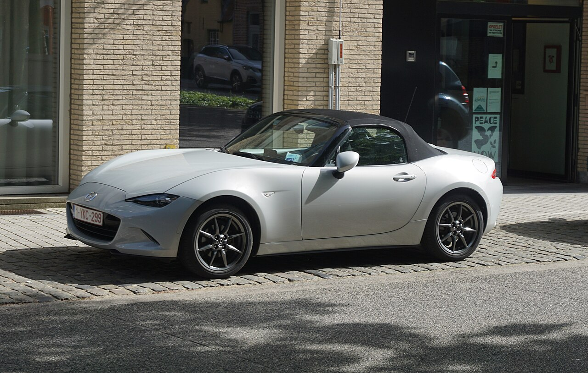
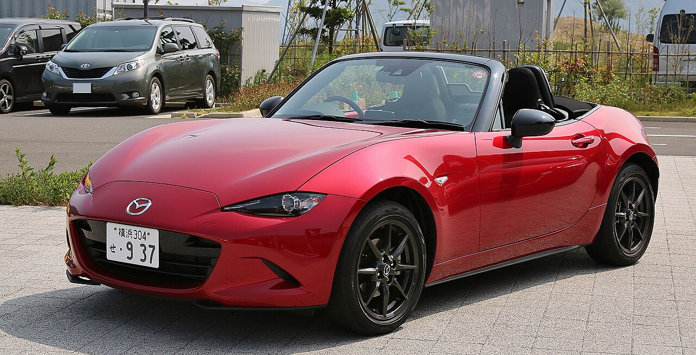

## Ficha editorial

- **Estado:** contenido integrado en `src/pages/guias/mazda-mx-5-nd-futuro-ne.astro`. Esta ficha se conserva como respaldo editorial; la página Astro es la versión que se publica.
- **Intención de búsqueda:** entender qué cambia en el Mazda MX-5 ND 2027 y qué se sabe realmente de su sucesor.
- **Público:** aficionados a los deportivos ligeros y compradores que valoran adquirir un MX-5 o esperar.
- **Categoría propuesta:** Comparar coches.
- **URL propuesta:** `/guias/mazda-mx-5-nd-futuro-ne/`
- **Título SEO:** Mazda MX-5 2027 y futuro NE: qué sabemos | Kilómetro Claro
- **Metadescripción:** Qué cambia en el Mazda MX-5 2027 y qué se ha confirmado de su sucesor: motor, peso objetivo, cambio manual y fecha, sin convertir rumores en datos.
- **Fecha de revisión:** 29 de octubre de 2026.
- **Autoría propuesta:** Equipo editorial de Kilómetro Claro. No se atribuye una prueba de conducción ni una experiencia personal no realizada.

# Mazda MX-5 ND 2027 y futuro «NE»: qué sabemos de verdad

El Mazda MX-5 2027 estrena cambios de equipamiento y una actualización mecánica, pero sigue siendo una evolución del modelo actual, no la quinta generación. El sucesor —al que medios y aficionados llaman a menudo «NE»— aún no tiene nombre comercial, ficha técnica ni fecha de lanzamiento confirmados por Mazda. Las declaraciones de sus responsables apuntan a que la marca estudia distintas soluciones para conservar un deportivo ligero y viable durante muchos años; todavía no permiten afirmar si será híbrido, eléctrico o exclusivamente de gasolina.

La distinción importa para quien esté pensando en comprar. El ND se puede comparar hoy con versiones y precios concretos; el futuro coche solo puede analizarse a partir de objetivos y declaraciones. Aquí separamos ambas cosas y explicamos qué decisión puede tomar un comprador con la información disponible.

> **En pocas palabras:** el MX-5 2027 actualiza el ND. «NE» es una denominación provisional, no un nombre confirmado; el tipo de propulsión, la transmisión y el calendario del sucesor siguen abiertos.

*Un Mazda MX-5 ND fotografiado en Brujas en mayo de 2026. Es una imagen de la generación actual; no muestra el acabado ni la especificación 2027. Foto de [2538O en Wikimedia Commons](https://commons.wikimedia.org/wiki/File:Mazda_MX-5_ND.jpg), publicada bajo [CC0 1.0](https://creativecommons.org/publicdomain/zero/1.0/deed.es).*

## Qué cambia en el Mazda MX-5 2027

La actualización de año-modelo refina el coche que ya conocemos. Mazda España anunció el 9 de junio de 2026 un 1.5 atmosférico Skyactiv‑G de **136 CV y 155 Nm**, junto a ajustes de gama y equipamiento. La marca declara para ese modelo un consumo combinado WLTP de 6,1 l/100 km y 139 g/km de CO₂; son cifras de homologación, no una promesa de consumo real en cualquier trayecto. El comunicado también indica que el detector de fatiga pasa a ser de serie y que el color Zinc Green llegará a los mercados a principios de 2027. [Comunicado oficial de Mazda España](https://es.mazda-press.com/news/2026/mazda_pr_press_release_mx-5_2027_sp_v2/).

| Novedad del año-modelo 2027 | Qué significa | Matiz |
| --- | --- | --- |
| Motor 1.5 Skyactiv‑G | Mazda anuncia 136 CV y 155 Nm para el motor atmosférico. | La nota publica cifras WLTP; no equivalen a un consumo medido por Kilómetro Claro. |
| Acabado Homura | Llantas RAYS negras de 16 pulgadas, frenos Brembo rojos, amortiguadores Bilstein y barra entre torretas delantera. | El equipamiento depende del acabado y del mercado. |
| Edición Yakudo | Acabado especial para Soft Top, con detalles plateados, frenos Brembo plateados y Alcantara. | No se ofrece en todas las carrocerías. |
| Detector de fatiga | Mazda lo incorpora de serie en la gama anunciada. | Conviene comprobar el equipamiento de la unidad concreta. |
| Zinc Green | Nuevo color para la gama. | Mazda anunció su llegada a partir de principios de 2027. |

La presentación de Mazda habla del **MX-5 2027** y de una evolución de la gama; no anuncia una generación nueva. Por eso no conviene interpretar «2027» como el año de llegada del sucesor. En España, la página de Mazda mostraba como referencias de acceso 33.500 € para el MX‑5 ST y 36.000 € para el RF al revisar esta guía. Son PVP recomendados publicados por la marca para Península y Baleares, con IVA, transporte e impuesto de matriculación incluidos; solicita un presupuesto para confirmar acabado, disponibilidad y condiciones vigentes. [Gama oficial de Mazda España](https://www.mazda.es/gama/).

El comunicado español identifica el motor 1.5 actualizado. Para comparar una unidad nueva de año-modelo 2027 con un MX-5 de ocasión, no mezcles automáticamente sus datos con los de versiones anteriores o con las de otros países: el motor, el equipamiento y la homologación pueden cambiar según año, mercado y acabado. La ficha técnica y el Certificado de Conformidad de la unidad concreta son las referencias adecuadas.

### Soft Top o RF: dos formas de vivir el mismo roadster

El Soft Top combina el formato de capota de lona con una carrocería abierta; el RF ofrece un techo rígido retráctil y una silueta más próxima a la de un coupé cuando va cerrado. Ninguna carrocería es automáticamente mejor: importan el clima, el aparcamiento, el uso habitual con el techo abierto, el acceso al habitáculo y el espacio de equipaje.

Antes de elegir, merece la pena sentarse en ambos con el techo colocado, comprobar la visibilidad y probar la maniobra de apertura. Las fichas de Kilómetro Claro recogen por separado el [MX‑5 ST con capota de lona](/marcas/mazda/mx-5-st/) y el [MX‑5 RF con techo retráctil](/marcas/mazda/mx-5-rf/); la configuración vigente debe confirmarse en Mazda España o en un concesionario.

## «NE»: una etiqueta provisional, no una ficha de producto

«NE» se utiliza para hablar de la siguiente generación, pero no es un nombre comercial confirmado. En febrero de 2026, Christian Schultze, responsable de investigación y operaciones de Mazda Motor Europe, explicó a AutoRAI que la generación actual se llama ND y que la siguiente quizá se denomine NE, sin poder confirmar ese nombre. La entrevista decía también que Mazda trabajaba con distintas posibilidades y que existía un prototipo; eso no equivale a que la marca haya presentado un coche de producción o publicado su diseño. [Entrevista de AutoRAI a responsables de Mazda Motor Europe, febrero de 2026](https://autorai.nl/interview-opvolger-mazda-mx-5/).

En septiembre, Martijn ten Brink, CEO de Mazda Motor Europe, explicó que la decisión técnica depende de la evolución regulatoria y de las preferencias de los clientes. Habló de varios conceptos estudiados, de la importancia de desarrollar un coche capaz de mantenerse en el mercado durante un ciclo prolongado y de no fijar una solución antes de que el contexto esté más claro. Cuando mencionó los próximos dos años se refería al horizonte para entender la regulación antes de decidir el concepto técnico: **no anunció que el coche vaya a presentarse o venderse en dos años**. [Entrevista de AutoRAI a Martijn ten Brink, 18 de septiembre de 2026](https://autorai.nl/mazda-is-geduldig-met-nieuwe-generatie-mx-5-als-de-nieuwe-generatie-er-komt-moet-die-minstens-10-jaar-meegaan/).

### ¿Hay ya una imagen real del sucesor?

No hemos encontrado una fotografía oficial pública del supuesto NE. AutoRAI muestra recreaciones editoriales del futuro MX-5 y una de ellas aparece identificada como render creado con Gemini. Son interpretaciones visuales, no fotografías de un prototipo presentado por Mazda ni una confirmación de su diseño. [Puedes ver la recreación en la página de AutoRAI](https://autorai.nl/interview-opvolger-mazda-mx-5/), pero no la reproducimos aquí: no hemos localizado una autorización de uso para incorporarla y podría confundirse con una imagen oficial.

*Un Mazda Roadster ND rojo fotografiado en 2015. La imagen ilustra el modelo actual y no anticipa el aspecto de su sucesor. Foto de [TTTNIS en Wikimedia Commons](https://commons.wikimedia.org/wiki/File:Mazda_Roadster_ND.jpg), publicada bajo [CC0 1.0](https://creativecommons.org/publicdomain/zero/1.0/deed.es).*

## Motor y electrificación: qué está confirmado y qué no

Las declaraciones públicas no componen todavía una gama futura. En febrero, Jo Stenuit, director de diseño de Mazda en Europa, habló de asistencia eléctrica como una posibilidad y de un planteamiento todavía no cerrado. En septiembre, Ten Brink insistió en que la tecnología debe encajar con la regulación, el mercado y la vida útil que Mazda espera para el modelo. En julio, el presidente global Masahiro Moro añadió que el sucesor debería estar preparado para un escenario sin motor de combustión.

Esta última frase no significa que Mazda haya confirmado un MX‑5 eléctrico. En la misma información, MotorTrend atribuyó a Mazda USA la confirmación de que la empresa estudia varias posibilidades de propulsión. «Prepararse para un escenario» describe una opción de desarrollo, no una versión aprobada, un calendario ni una promesa de venta. Para entender las diferencias entre microhibridación, híbrido convencional y enchufable, consulta nuestra guía sobre [híbridos, híbridos enchufables y microhíbridos](/guias/coche-hibrido-enchufable-o-microhibrido/).

### El objetivo de masa: una pista, no el peso homologado

MotorTrend informó de una entrevista al presidente Masahiro Moro y de una respuesta posterior de Mazda USA: se está considerando un objetivo de masa de entre aproximadamente 1.000 y 1.200 kg para preservar la experiencia Jinba Ittai. La horquilla es una meta de desarrollo, no el peso final de un coche homologado. Tampoco se ha especificado si se cumpliría igual en cada carrocería o sistema de propulsión. [MotorTrend, con la declaración de Mazda USA](https://www.motortrend.com/news/mazda-ceo-details-next-mx-5-miata).

¿Por qué importa la masa en un deportivo pequeño? A igualdad de velocidad, la energía cinética aumenta en proporción a la masa: en un ejemplo teórico, un coche de 1.200 kg acumula un 20 % más de energía que uno de 1.000 kg. La expresión es **E = ½ × m × v²**. Esa diferencia influye en el trabajo que deben gestionar frenos y neumáticos, pero **no permite concluir que la distancia de frenado aumente un 20 %**: también intervienen el agarre, los neumáticos, el reparto de masas, la suspensión y el sistema de frenado.

Reducir kilos no basta para asegurar que un coche sea ágil o agradable. También hay que valorar la ubicación de la masa, la respuesta del motor, la dirección, la puesta a punto y el control de la carrocería. El objetivo sirve para entender las prioridades declaradas por Mazda; no permite anticipar cómo conducirá el modelo.

### ¿Se conservará el cambio manual?

El cambio manual sigue siendo una preferencia expresada por directivos de Mazda, pero no está confirmado para una versión de producción. En septiembre, Ten Brink dijo que prefería una caja manual, condicionada a las exigencias de emisiones y a la tecnología que acabe utilizando el coche. También señaló la dificultad de combinar una caja manual con determinados sistemas híbridos.

Así que la respuesta honesta es «no se sabe». Mazda trabaja con soluciones distintas y la entrevista no despeja qué llegará al mercado español. Si el tipo de transmisión pesa en tu decisión, nuestra guía explica cómo diferenciar los [tipos de cambio automático](/guias/tipos-cambio-automatico/); y para entender qué implica que un coche impulse las ruedas traseras, puedes consultar la guía sobre [tracción delantera, trasera, total y 4x4](/guias/tipos-traccion-coche/).

## Alternativas deportivas disponibles o cercanas en España

No son sustitutos equivalentes del MX‑5: cambian la carrocería, el precio, la disponibilidad y el tipo de uso. La comparación resulta más útil si sirve para descubrir qué formato se ajusta a cada comprador, no para declarar un ganador.

| Modelo | Qué ofrece frente al MX‑5 | Situación indicada por la marca al revisar |
| --- | --- | --- |
| **Mazda MX‑5 ST / RF 2027** | Dos plazas y carrocerías de capota de lona o techo rígido retráctil; la gama española anuncia el 1.5 actualizado. | Mazda España publica PVP desde 33.500 € para ST y 36.000 € para RF. Comprueba acabado y disponibilidad. |
| **BMW Z4** | Roadster biplaza de planteamiento parecido, aunque con otra oferta mecánica y de transmisiones según versión. | BMW anunció que la producción terminaría en marzo de 2026 y que España tendría diez unidades Final Edition. En octubre, conviene comprobar si queda alguna unidad nueva; también puede buscarse en ocasión. |
| **Alpine A110** | Deportivo biplaza cerrado y de motor central: una alternativa más orientada al coupé que a conducir a cielo abierto. | Alpine España lo anuncia como modelo con últimas unidades en sus tiendas y señala que ya no se configura por encargo. |
| **Toyota GR86** | Coupé de dos plazas más dos asientos traseros pequeños; no ofrece la experiencia de un roadster. | La página española dirige al comprador hacia vehículos GR86 de ocasión. Comprueba el estado y el historial de cada unidad. |

Fuentes de disponibilidad: [Mazda España](https://www.mazda.es/gama/), [BMW Group España](https://www.press.bmwgroup.com/spain/article/detail/T0454328ES/el-bmw-z4-final-edition-una-versi%C3%B3n-exclusiva-del-emblem%C3%A1tico-roadster), [Alpine España](https://www.alpinecars.es/gama/a110.html) y [Toyota España](https://www.toyota.es/coches/gr86). Las páginas y el stock pueden cambiar; los datos describen lo que publicaban al revisar el borrador, no garantizan que haya una unidad disponible en un concesionario concreto.

La diferencia de formato es determinante: el Z4 es el rival conceptual más cercano como roadster; el A110 y el GR86 pueden interesar a quien acepta un techo fijo. Para una comparación más amplia de deportivos y arquitecturas, puedes leer nuestra guía del [Toyota GR GT y sus posibles rivales](/guias/toyota-gr-gt/), teniendo presente que se trata de un proyecto de otra categoría.

## ¿Comprar un MX‑5 ND ahora o esperar al sucesor?

**El ND es la única decisión que se puede valorar con una ficha, un presupuesto y una prueba reales.** Si te encaja la carrocería, te bastan sus prestaciones y encuentras un precio asumible, no descartes el coche solo porque circule una fecha no oficial para el sucesor. Comprueba postura, visibilidad, acceso, equipaje, seguro, mantenimiento y disponibilidad del acabado; solicita una oferta por escrito y prueba Soft Top y RF si ambas opciones te interesan.

Esperar puede tener sentido si solo comprarías un MX‑5 con una tecnología concreta que el ND no ofrece, por ejemplo una configuración electrificada determinada. Pero asumirás que todavía no se conocen su fecha, precio, prestaciones ni disponibilidad en España. Una preferencia personal es un motivo válido para esperar; un rumor no es una garantía de producto.

**Nuestra lectura editorial:** nos alegra que Mazda hable de masa, equilibrio y participación del conductor, no solo de potencia máxima. Eso no demuestra que el futuro coche vaya a conservar cada rasgo del ND. La prueba estará en una ficha definitiva, en el precio y en el comportamiento medido por medios independientes. Hasta entonces, el MX‑5 2027 merece análisis como la evolución del modelo actual y el «NE» debe seguir tratándose como una incógnita.

## Preguntas frecuentes

### ¿El Mazda MX‑5 2027 es una nueva generación?

No. Mazda presenta el 2027 como una evolución de la gama actual, con cambios de equipamiento, color y una actualización del 1.5 Skyactiv‑G. La marca no lo anuncia como una nueva generación.

### ¿Está confirmado que el futuro MX‑5 se llamará NE?

No. En una entrevista de febrero de 2026, un responsable de Mazda Motor Europe dijo que quizá se llamase NE, pero no confirmó esa denominación.

### ¿El sucesor será eléctrico o híbrido?

No hay una versión comercial confirmada. Responsables de Mazda han hablado de distintas soluciones posibles y de prepararse para escenarios con y sin motor de combustión; eso no equivale a anunciar una gama eléctrica o híbrida.

### ¿Cuándo se presentará el siguiente MX‑5?

Mazda no ha publicado una fecha de presentación o venta del sucesor en las fuentes consultadas hasta el 29 de octubre de 2026. El horizonte de dos años mencionado en una entrevista se refiere a valorar el contexto técnico y regulatorio, no a un lanzamiento anunciado.

### ¿Está confirmado el cambio manual?

No. El CEO de Mazda Motor Europe ha expresado preferencia por conservarlo, pero ha condicionado la decisión a la futura tecnología y regulación.

### ¿El objetivo de masa significa que el NE pesará 1.000 kg?

No. La cifra divulgada es un objetivo amplio, de aproximadamente 1.000 a 1.200 kg. No es una masa homologada ni una especificación final para una versión determinada.

## Fuentes y método

Información revisada el **29 de octubre de 2026**. Se han separado especificaciones comunicadas por Mazda, declaraciones de responsables, objetivos de desarrollo y opinión editorial. No hemos probado los coches citados ni recibido datos exclusivos de los fabricantes. Los precios y la disponibilidad son referencias temporales y deben comprobarse antes de comprar.

- [Mazda España: comunicado del MX‑5 2027, 9 de junio de 2026](https://es.mazda-press.com/news/2026/mazda_pr_press_release_mx-5_2027_sp_v2/).
- [Mazda España: página de gama y precios de acceso](https://www.mazda.es/gama/).
- [AutoRAI: entrevista a Jo Stenuit y Christian Schultze, 23 de febrero de 2026](https://autorai.nl/interview-opvolger-mazda-mx-5/). La publicación etiqueta sus ilustraciones del sucesor como recreaciones.
- [AutoRAI: entrevista a Martijn ten Brink, 18 de septiembre de 2026](https://autorai.nl/mazda-is-geduldig-met-nieuwe-generatie-mx-5-als-de-nieuwe-generatie-er-komt-moet-die-minstens-10-jaar-meegaan/).
- [MotorTrend: objetivo de masa citado por el presidente de Mazda y respuesta de Mazda USA, 3 de agosto de 2026](https://www.motortrend.com/news/mazda-ceo-details-next-mx-5-miata).
- [BMW Group España: anuncio de la Final Edition y fin previsto de producción del Z4](https://www.press.bmwgroup.com/spain/article/detail/T0454328ES/el-bmw-z4-final-edition-una-versi%C3%B3n-exclusiva-del-emblem%C3%A1tico-roadster).
- [Alpine España: A110 y últimas unidades](https://www.alpinecars.es/gama/a110.html).
- [Toyota España: página del GR86](https://www.toyota.es/coches/gr86).
- Imágenes del ND: [Mazda MX‑5 ND, autor 2538O, CC0](https://commons.wikimedia.org/wiki/File:Mazda_MX-5_ND.jpg) y [Mazda Roadster ND, autor TTTNIS, CC0](https://commons.wikimedia.org/wiki/File:Mazda_Roadster_ND.jpg). Los enlaces anteriores incluyen las condiciones de cada archivo.

**Enlaces internos integrados:** fichas del MX‑5 ST y RF, guía de tipos de cambio automático, guía de tipos de tracción, guía sobre sistemas híbridos y guía del Toyota GR GT.
